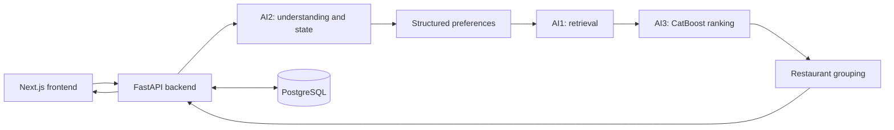

# Tastly — AI-Powered Food Recommendation System

Tastly helps people decide what to eat through conversational preferences, food retrieval, recommendation ranking and a restaurant map. Describe a dish, budget, distance or dietary preference, refine the request over several turns, and explore recommendations in Vietnamese or English.

**Status:** an integrated academic/demo application. The supplied catalog is a **synthetic demo**, not a verified directory of real restaurant menus. Menu availability, prices, nutrition, amenities and dietary suitability must not be treated as verified real-world facts. Some restaurant IDs and locations originate from source records; that does not verify their current accuracy.

## Features

- **AI1 — Constraint-aware food retrieval:** filters a structured catalog using preferences, food matching, location and multilingual embedding similarity. Dataset IDs are preserved throughout the pipeline.
- **AI2 — LLM-first conversational understanding:** uses OpenRouter for structured intent, preference updates and replies, then manages conversation state. Cloud fallback profiles and optional local Qwen support are implemented.
- **AI3 — CatBoost recommendation ranking:** scores retrieved candidates with the included CatBoost YetiRank model and its 15-feature schema.
- **Restaurant grouping:** shows distinct restaurants with representative dishes. Primary results and supplementary suggestions are separate; supplementary results remain qualified alternatives rather than guaranteed matches for every preference.
- **Complete website:** Next.js/React frontend, FastAPI backend, PostgreSQL accounts/sessions, synchronized search/chat preferences and map markers. Leaflet/OpenStreetMap works without a token; optional Mapbox adds its map and location search.

## Architecture



AI1 and AI3 consume structured state; neither parses prompts. AI2 does not retrieve or rank restaurants. Shared Pydantic v2 contracts live in `src/common/schemas.py`. The injectable direct Python pipeline runs independently of the website/database.

```text
src/
  common/          Shared schemas and interfaces
  conversation/    AI2 providers, parsing, safety and state
  retrieval/       AI1 filters, catalog loading and vector search
  ranking/         AI3 features, inference and evaluation
  pipeline/        Python orchestration and restaurant selection
  backend/         FastAPI routes, services and database adapters
  database/        Database connections and repositories
  frontend/        Next.js app, assets, tests and npm lockfile
data/              DATA_DOWNLOAD.txt; actual datasets are external
models/            CatBoost artifacts and optional Qwen configuration
database/          PostgreSQL schema, indexes and procedures
scripts/           Setup, provisioning and development utilities
tests/             Offline unit, contract and integration tests
examples/          Injectable integration demo and AI1 examples
docs/              Module contracts and implementation notes
setup.ps1          Windows setup and validation
compose.yaml       Local PostgreSQL service
```

## Requirements

| Use case | Requirements |
| --- | --- |
| Core AI2/contracts tests and injected demo | Python **3.11**, pip and Git; no dataset, API key, Node.js, GPU or database server |
| Full offline Python regression suite | Python 3.11 plus project test/AI1/AI3/backend/database dependencies; one smoke test also needs demo data |
| Complete website | Python 3.11, Node.js **20.9+** with npm (Node 22/24 LTS recommended), demo data, query encoder, OpenRouter API key and PostgreSQL |
| Database through setup | Docker Desktop running Linux containers with Docker Compose; alternatively initialize PostgreSQL 17 yourself |
| Optional local Qwen | Additional model files, NVIDIA/CUDA support and SLM dependencies described below |

Git LFS is **not required for this public distribution**. Large Qwen weights/tokenizer bundles are external; the required CatBoost model is an ordinary Git file. Python dependencies use bounded ranges; frontend dependencies have an npm lockfile. Python installation is not yet locked to identical transitive versions across dates/platforms.

## Windows PowerShell setup

### 1. Clone and download demo data

```powershell
git clone https://github.com/Kh4nq/tastly-food-recommender.git
Set-Location tastly-food-recommender
```

Download **[ai1-demo-data.zip from Google Drive](https://drive.google.com/file/d/1rlEWKszmCnGi9HIP6bD9MUz8EEwtbE60/view?usp=sharing)**. The maintained link is also in [`data/DATA_DOWNLOAD.txt`](data/DATA_DOWNLOAD.txt). Place the actual downloaded ZIP at:

```text
tastly-food-recommender/data/ai1-demo-data.zip
```

The ZIP contains `processed/`, `embeddings/` and `dataset_manifest.json` directly at its root. Do not wrap them in another folder or mix releases. If a downloaded copy is named `ai1-data.zip`, rename it to **`ai1-demo-data.zip`**.

When active artifacts are missing or invalid, `setup.ps1` invokes `scripts/setup_artifacts.py` to stage the ZIP, verify its manifest, SHA256 checksums, metadata, vector shapes, IDs and mappings, then provision validated files. Setup never regenerates data. If active data is already valid, setup preserves it and **does not validate the ZIP**. Restart the backend after changing datasets.

Custom ZIP locations remain supported:

```powershell
.\setup.ps1 -SkipSlm -WithDatabase -WithFrontend -AI1ArtifactZip "$HOME\Downloads\ai1-demo-data.zip"
```

### 2. Configure the backend

For a new clone:

```powershell
Copy-Item .env.example .env
notepad .env
```

Edit your existing `.env` on an existing installation. Setup creates it only when absent. Configure:

```dotenv
LLM_PROVIDER=openrouter_chain
OPENROUTER_ENABLED=true
OPENROUTER_API_KEY=your_openrouter_api_key
AI2_LLM_FIRST_ENABLED=true
AI2_RULE_FALLBACK_ENABLED=false
LOCAL_SLM_ENABLED=false
AI1_EMBEDDING_DEVICE=cpu
BACKEND_AI_TIMEOUT_S=120
```

Obtain your own key from your OpenRouter account. Keep it in the backend `.env` or process environment; never commit it or put it in a `NEXT_PUBLIC_` variable. Live cloud requests can incur provider charges. Setup, preflight, tests and the offline demo do not call paid LLMs.

The chain's model identifiers are in `.env.example` and validated by the current code. Account access, provider availability and usage limits affect live requests. The legacy Gemini path uses `GEMINI_API_KEY` and `GEMINI_MODEL`; these are not required for OpenRouter. The backend loads root `.env`; core library calls read process variables unless the calling tool explicitly loads `.env`.

Choose a local `POSTGRES_PASSWORD` and keep `DATABASE_URL`, `POSTGRES_USER`, `POSTGRES_DB` and `POSTGRES_PORT` consistent. URL-encode password special characters in `DATABASE_URL`. Example credentials are for local development; replace them before deploying.

### 3. Install and initialize

Start Docker Desktop, then run from the repository root:

```powershell
.\setup.ps1 -SkipSlm -WithDatabase -WithFrontend
```

Setup creates a Python 3.11 `.venv`, installs Python extras, provisions demo data, checks dependencies/artifacts, runs `npm ci`, starts PostgreSQL, applies SQL schema/indexes/procedures and seeds an empty database. `-SkipSlm` avoids optional CUDA/Qwen installation. Setup does not start the website servers.

If PowerShell blocks scripts, use a process-scoped invocation where your policy permits it:

```powershell
powershell -ExecutionPolicy Bypass -File .\setup.ps1 -SkipSlm -WithDatabase -WithFrontend
```

For an unrelated existing `.venv`, choose `-VenvPath .venv-tastly` and use that interpreter below. Setup preserves existing environments. Database seeding uses `--if-empty`; a nonempty database is preserved. Use a separate empty database for a different catalog.

The ZIP supplies precomputed vectors, but live queries also need `sentence-transformers/paraphrase-multilingual-MiniLM-L12-v2`. The lazy loader downloads this query encoder from Hugging Face on first use if uncached. Allow internet access for initial startup or pre-cache it separately. Preflight checks cache presence without downloading and cannot guarantee a complete cache.

### 4. Start the backend

From the repository root:

```powershell
.\.venv\Scripts\python.exe -m uvicorn backend.main:create_production_app --factory --host 127.0.0.1 --port 8000
```

API docs: [http://127.0.0.1:8000/docs](http://127.0.0.1:8000/docs). Production wiring requires initialized PostgreSQL. Startup normally warms up retrieval/ranking, so data and the query encoder must be available. Disabling warmup postpones these requirements until search.

### 5. Start the frontend

Open another terminal at the clone root:

```powershell
Set-Location src/frontend
npm.cmd run dev
```

Open [http://localhost:3000](http://localhost:3000). Next.js forwards `/api/*` to `http://127.0.0.1:8000`. Optional settings belong in `src/frontend/.env.local`; restart Next.js after changing them:

```dotenv
BACKEND_URL=http://127.0.0.1:8000
# NEXT_PUBLIC_MAPBOX_ACCESS_TOKEN=your_public_mapbox_token
# NEXT_PUBLIC_WEB3FORMS_ACCESS_KEY=your_public_contact_form_key
```

Without Mapbox, the map uses Leaflet/OpenStreetMap and Mapbox address lookup is unavailable. Geolocation needs browser permission and a secure context; localhost is supported. Contact delivery needs its own Web3Forms key. Tiles/geocoding/contact delivery require network access and their service terms apply. Next.js also fetches Google Fonts during builds.

## AI-only development and verification

A small dataset-free offline setup:

```powershell
py -3.11 -m venv .venv
.\.venv\Scripts\python.exe -m pip install -e ".[test]"
.\.venv\Scripts\python.exe -m pytest -q tests/test_common_contracts.py tests/test_conversation.py tests/test_pipeline_mock.py tests/test_schema_v02.py
.\.venv\Scripts\python.exe examples/integration_demo.py
```

The example injects synthetic retrieval/ranking and disables model inference. It validates contracts/state flow, not real recommendation quality.

For all Python dependencies and demo data, without Node.js, a database server or local Qwen:

```powershell
.\setup.ps1 -SkipSlm -SkipFrontend
.\.venv\Scripts\python.exe -m pytest -q -p scripts.sealed_benchmark_guard
.\.venv\Scripts\python.exe examples/integration_demo.py
.\.venv\Scripts\python.exe scripts/preflight.py --ai1-only
.\setup.ps1 -SkipSlm -SkipFrontend -VerifyOnly
```

The protected benchmark prompt file is not distributed. The guarded suite skips its readers. For a code-only clone before downloading data, also add `--ignore=tests/test_ai2_ai1_smoke.py`. Optional UI/SLM dependencies can cause skips. Socket guards block provider calls. Preflight's Gemini/Qwen messages describe optional paths; missing keys/models for them do not prevent OpenRouter use.

Frontend checks from `src/frontend` after `npm ci`:

```powershell
node --test tests/*.test.mjs
npm.cmd run lint
npm.cmd exec tsc -- --noEmit
npm.cmd run build
# Serve a production build with: npm.cmd start
```

## Optional local Qwen

`LOCAL_SLM_ENABLED=false` remains the default. Local inference additionally needs:

1. A suitable NVIDIA GPU/driver and CUDA-enabled PyTorch passing the tensor check. Setup without `-SkipSlm` detects NVIDIA and attempts `.[slm]`. Review its CUDA wheel/index for your machine; package installation alone does not prove inference works.
2. A complete `Qwen/Qwen3-1.7B` base cache or local base directory, and matching LoRA weights/tokenizer supplied separately by maintainers. **The public repository does not include the adapter bundle or an automatic adapter download.** The AI1 ZIP does not contain it.
3. The matching configuration, weights, tokenizer and chat template at your adapter path. See [optional adapter notes](models/ai2/ai2-qwen3-1.7b-lora-targeted-v3/README.md).

After obtaining those files, explicitly set `LOCAL_SLM_ENABLED=true`, `LOCAL_SLM_BASE_MODEL` and `LOCAL_SLM_ADAPTER_PATH`. For cloud-chain local fallback, also point `LOCAL_SLM_FALLBACK_ADAPTER_PATH` to a matching supplied adapter; the experimental default directory is external. Keep `LOCAL_SLM_LOCAL_FILES_ONLY=true` for offline loading. Run `python scripts/preflight.py --require-local-slm` using the project interpreter to check the standard V3 layout. Preflight is not an inference test. Model licenses/hardware requirements apply separately; normal website setup does not train models.

## Troubleshooting

| Symptom | Check |
| --- | --- |
| Python 3.11 missing | Install Python 3.11 and its Windows `py` launcher; inspect `py -0p`. A newer default Python does not satisfy setup's 3.11 check. |
| Invalid/missing AI1 files | Check ZIP name/root layout and rerun setup. Obtain a matching archive; never edit hashes/metadata to bypass validation. |
| Drive download is HTML | Download the actual archive from the preview. Check sharing permissions if inaccessible. |
| Backend startup fails | Check PostgreSQL/Docker health, database URL, schema/seed and model access. Keep custom database ports consistent. |
| Slow first startup/search | Allow the query encoder to download/load. CPU query encoding can coexist with optional Qwen. |
| Chat interpretation fails | Check backend OpenRouter key, enabled flag, provider and account/model access. |
| Frontend API error | Start the backend, check `/docs` and `BACKEND_URL`. Two cloud attempts can exceed the default 30-second backend limit; the configuration above allows 120 seconds. |
| Build cannot fetch fonts | Allow Google's font endpoints used by Next.js. |

## Limitations and attribution

This is a demo rather than a production service or food-safety tool. Coverage/metadata completeness are limited. Allergy, nutrition, opening-hours and availability information may be missing or synthetic. Ranking scores are not probabilities or verified quality guarantees. The model's independent evaluation and training-split provenance are not fully documented. Personalization modules are reserved scaffolding; some peripheral pages contain illustrative content.

Secrets, private conversations/labeling records, backups, caches, dataset ZIPs, extracted Parquets and embeddings are excluded from Git. Historical development reports remain context; use this README and [setup](docs/setup.md) for the public distribution. See [release verification](docs/RELEASE_VERIFICATION.md), [architecture](docs/architecture.md), [contracts](docs/integration_contract.md), [AI1](docs/ai1_retrieval.md), [AI2](docs/ai2_conversation.md) and [AI3](docs/ai3_ranking.md) for implementation details.

Third-party libraries, models, map data and assets retain their licenses/attribution. Contributor credits and map attribution are preserved. No blanket license is asserted for third-party data or assets; see [third-party notices](THIRD_PARTY_NOTICES.md).
