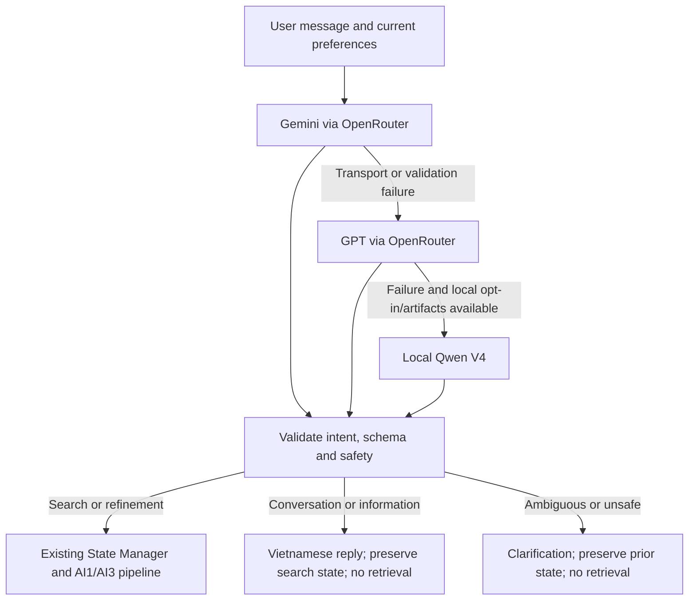

# Tastly AI2: LLM-first conversation

Latest upstream synchronization, search-correctness fixes and verification:
[2026-10-15 search handoff](FULLSTACK_SEARCH_SYNC_20261015.md).
Current grouped recommendation contract:
[final recommendation handoff](RESTAURANT_RECOMMENDATION_FINAL.md).
Contextual unitless VND grounding, search-status chat replies and removal of the
post-ranking explanation feature: [budget/chat final handoff](AI2_BUDGET_CHAT_FINAL.md).

The default `LLM_PROVIDER=openrouter_chain` workflow now interprets every nonempty
message with a single structured Gemini turn. Its response includes intent, an
existing v0.2 preference delta, a Vietnamese reply and supporting source quotes.
There is no separate classification call and no mandatory Rule Parser pass.
Form-only submissions and deferred searches need no LLM call.



## Files and compatibility

| Area | Changes |
| --- | --- |
| conversation/llm_first.py | One-call interpretation, ordered provider fallback, validation before state commit, non-search handling |
| conversation/grounding.py, safety.py, evidence.py | Quoted provenance, canonical food aliases, numeric units/values, hard-constraint/coordinate/allergy/reference safeguards |
| conversation/providers/openrouter_provider.py, structured.py, prompts.py | Additive internal conversation projection and prompt; shared HTTP transport; temporary debug prints removed |
| conversation/parser.py, config.py, environment.py, models.py, conversation_logger.py | LLM-first dispatch/configuration; intent/reply metadata; no logging of assistant reply bodies |
| backend/ports.py, adapters/ai2_conversation.py, services/search_service.py, api/schemas.py, api/routes_search.py | Propagate intent/reply; skip retrieval and session writes for ordinary chat; defer search until location selection |
| frontend/lib/api.ts, ChatWidget.tsx, SearchPreferenceProvider.tsx | Display assistant replies, preserve results/preferences on chat, classify without a location picker, resume deferred searches without repeating interpretation |
| pipeline/recommend.py | Default direct pipeline also honors clarification/non-search metadata and exact rollback |
| tests/test_llm_first.py, tests/backend/test_llm_first_web.py | Authored offline safety, transport, intent, state, fallback and HTTP regressions |
| tests/test_ai2_production_pipeline.py, tests/backend/test_ai2_web_integration.py | Earlier rules-first behavior is tested explicitly with AI2_LLM_FIRST_ENABLED=false |

`common.schemas`, AI1/AI3 implementations, database code, dataset, map component,
model artifacts and dependencies were not changed. Existing public imports and
`parse_preference` remain available. Single-provider/none/mock configurations
retain their established compatibility behavior; the new conversational mode is
selected by `openrouter_chain`. Backend/frontend/shared-pipeline owners should
review these additive integration changes before any merge. No PR or commit was made.

## Why valid `3km` was rejected

The old `validate_model_delta` used `\bkm\b` as mandatory textual evidence.
Digits and letters are both word characters, so `3km` has no boundary before `k`.
Even a valid value of 3 km therefore failed with `Field lacks textual evidence`.

Distance now accepts attached units. The LLM-first path verifies the actual
number/unit pair instead of requiring phrases such as `trong vòng`. It supports
meters/kilometers, Vietnamese/English common units, compact budgets such as 100k,
grouped currency amounts and common word numbers. The same value cannot be
reinterpreted from minutes/money as distance. Upper/lower budget bounds and
unambiguous contradictory values are checked. A relative request cannot invent
an absolute number.

Model source quotes must occur in the current message. Food aliases/accents and
quoted semantic context need not match one regex spelling of a canonical label.
An unrelated quote cannot justify an invented dish. This remains bounded
grounding, not proof of arbitrary semantic correctness.

Safety validation still enforces Pydantic types, explicit form priority, no
invented coordinates, no cross-session/user processing, caller-owned reference
IDs, grounded mandatory constraints, allergy retention and target-scoped allergy
removal. Unknown allergy targets, ambiguous removals, incomplete local outputs
and unsupported numeric interpretations clarify instead of committing a guess.
Provider failure rolls back the whole AI2 update, including conflicting form data.
The backend also honors state_preserved, so a dirty browser snapshot cannot be
committed by a failed provider transaction; the stored state/version stay unchanged.
Existing serving categories remain supported: món nước selects food with
broth/soup styles, while a beverage switch clears stale food style and specific
food. An ambience refinement cannot silently clear the dish or become a mandatory
quietness filter without mandatory intent.

## Web API

`POST /api/search` retains its existing fields and response. Additive response fields:

- `intent`: search, refinement, informational, conversation or clarification;
  defaults to search for existing adapters/consumers.
- `assistant_message`: nullable Vietnamese reply. Search acknowledgments can
  continue to use the existing frontend text.
- `retrieval_deferred`: false by default.

The additive request flag `defer_retrieval` defaults to false. The existing UI sets
it when a chat message is sent without a location. AI2 can answer a greeting or
general question immediately. For a search, the accepted state is saved with empty
results; the UI requests a location, then resumes with that state and no message.
Thus location selection does not cause a second interpretation of the same text.
This adds no map lookup, geocoding implementation or intent-classifier component.

Informational/conversation responses have empty results and cannot mutate search
preferences. They do not invoke retrieval, ranking or map lookup, nor write the
session record. A dirty browser snapshot is not committed merely by saying hello.
The UI retains the prior search results, preferences and route while showing the reply.

Non-search replies contain general food discussion only. The prompt prohibits
restaurant facts/recommendations; post-validation rejects observable venue,
price, rating and availability claims. No catalog information is supplied as proof
of those facts. Refusals, malformed JSON and incomplete provider output remain errors.

## Configuration and fallbacks

No `.env` or frontend environment file was modified. Configure the backend only:

```dotenv
LLM_PROVIDER=openrouter_chain
OPENROUTER_ENABLED=true
OPENROUTER_API_KEY=<server environment only>
AI2_LLM_FIRST_ENABLED=true
AI2_RULE_FALLBACK_ENABLED=false
LOCAL_SLM_ENABLED=false
LOCAL_SLM_FALLBACK_ADAPTER_PATH=models/ai2/best_adapter_v4_experimental
```

The selected cloud profiles remain `google/gemini-3.5-flash-lite` then
`openai/gpt-5.4-mini`, with the existing reasoning parameters and retry/timeout
limits. Each provider is called at most once in a turn. A successful interpretation
does not call GPT or load a local model. Only sanitized bounded error codes,
model IDs and aggregate usage/cost metadata are retained; raw provider bodies and
temporary prints are not logged. Assistant reply bodies are excluded from the
conversation audit metadata too. Existing credential redaction remains active.

At handoff, the existing root `.env` still selects `gemini` with OpenRouter
disabled. It was deliberately left unchanged. To activate the new pipeline in a
backend terminal, use these process overrides; starting the server itself does
not call a paid conversation provider, but sending a chat message can:

```powershell
Set-Location '.'
$Python = '.\.venv\Scripts\python.exe'
$env:PYTHONPATH = "$PWD\src;$PWD"
$env:PYTHONDONTWRITEBYTECODE = '1'
$env:LLM_PROVIDER = 'openrouter_chain'
$env:OPENROUTER_ENABLED = 'true'
$env:AI2_LLM_FIRST_ENABLED = 'true'
$env:BACKEND_AI_TIMEOUT_S = '120'
# OPENROUTER_API_KEY stays in the server environment/root .env, never NEXT_PUBLIC_*.
& $Python -B -m uvicorn backend.main:create_production_app --factory --host 127.0.0.1 --port 8000
```

With the existing frontend running, manually check a greeting before choosing a
location, the phở-versus-bún question, an existing-search quietness refinement,
and the three numeric food requests. A greeting/question should preserve the
current page/results and avoid the location picker; a search without location
should ask for one and resume without another LLM call.

Set `LOCAL_SLM_ENABLED=true` to permit the final V4 fallback. It checks local files
and dependencies only after cloud failure, loads lazily and forces cache-only base
loading. A missing adapter/cache/GPU or failed inference safely clarifies. The
separate fallback path preserves standalone V3/V4 selection and rollback settings.
No weights were copied or retrained.

The trained Qwen LoRA produces preference deltas, not the new conversational
envelope. Consequently its final fallback is restricted to grounded search/refinement
requests; questions, greetings and ambiguous extraction do not become searches.
If cloud conversation is unavailable, the user gets a safe Vietnamese clarification.
Opt-in deterministic Rule Parser fallback runs after the cloud/local attempts,
only for a completely understood search. `AI2_LLM_FIRST_ENABLED=false` is an
explicit compatibility/rollback switch for the prior pipeline, not the default.

For local V4, use one backend inference slot and allow for cold-load latency:

```powershell
$env:LOCAL_SLM_ENABLED = 'true'
$env:BACKEND_AI_CONCURRENCY = '1'
$env:BACKEND_AI_TIMEOUT_S = '240'
```

Without local fallback, 120 seconds permits two existing 30-second cloud timeouts
plus retrieval/map work. The existing thread gate cannot cancel an already running
worker on timeout; its behavior was preserved.

## Verification

Run from the integration checkout. These commands reuse the existing environment
read-only and pin imports to the target; no environment is copied or repointed.

```powershell
Set-Location '.'
$Python = '.\.venv\Scripts\python.exe'
$env:PYTHONPATH = "$PWD\src;$PWD"
$env:PYTHONDONTWRITEBYTECODE = '1'
& $Python -B -m pytest -q -p scripts.sealed_benchmark_guard tests/test_llm_first.py tests/backend tests/test_ai2_production_pipeline.py tests/test_ai2_safety_patch.py tests/test_openrouter_provider.py tests/test_pipeline_mock.py
& $Python -B -m pytest -q -p scripts.sealed_benchmark_guard
& $Python -B examples/integration_demo.py
Push-Location src/frontend
npm.cmd run lint
npm.cmd run build
Pop-Location
```

All provider responses in tests are mocked; offline socket guards remain active.
Final focused backend/conversation regression: **378 passed, 23 skipped**.
Final full guarded suite: **1,766 passed, 49 skipped** (119.84 seconds), with no
missing-data test exclusion. The offline integration demo passed afterward.
Frontend `npm.cmd run build` (including TypeScript) and `npm.cmd run lint` passed.
Protected-file SHA256 checks found zero changes to 62 checked AI1/AI3/common/DB,
data/model, dependency and actual environment files.
Tests cover the three requested Vietnamese numeric searches, informal/unaccented
and English searches, quietness/relative feedback, Vietnamese/English chat and
food questions, multi-turn updates, forms, quoted evidence, allergies, unsupported
constraints, model errors, local fallback, exact rollback and retrieval suppression.
HTTP tests also verify the real provider wire format/profiles and no second model
call after deferred location selection.

A real cache-only V4 probe with network sockets blocked and both cloud factories
simulated as failed accepted `Tìm ramen dưới 150k trong 3km`, producing food=ramen,
budget_max=150000 and max_distance_km=3 through the actual new fallback path.
This is one authored structural/functional probe, not a model-quality measurement.

Verification reports and protected-file checksums are in `logs/ai2-llm-first/`.
The older [web runbook](AI2_WEB_INTEGRATION.md) is a historical integration record;
its statements about rules bypassing cloud and cloud skipping local refer to the
previous mode. For a manual simulated-primary failover in its startup snippet,
patch `conversation.llm_first.create_provider` for the current default mode.

## Remaining validation

No paid OpenRouter call was run. The updated conversation JSON schema, generated
replies, reasoning/token-budget behavior and real provider latency/failover have
not been tested live. Intent classification and general-knowledge reply quality
still depend on the models; finite grounding checks cannot prove arbitrary language
semantics or catch every possible unsupported factual assertion.

Browser-control tooling was unavailable in this session. Frontend build/types/lint
and HTTP/deferred-flow tests were run; visual browser interaction and real
database-backed web E2E remain manual checks. Search refinements receive saved
preferences and supplied previous results; a separate persistent transcript of
general conversation is not added to the search-state schema.

AI1 still owns enforcement and evidence coverage for mandatory attributes. An
unsupported allergen/ETA filter must remain an actionable error, not a claim of
safe matching restaurants. Existing downstream error rollback is retained; a failed
retrieval does not commit a new non-deferred search state. No production readiness
or general model-accuracy claim follows from these checks.
